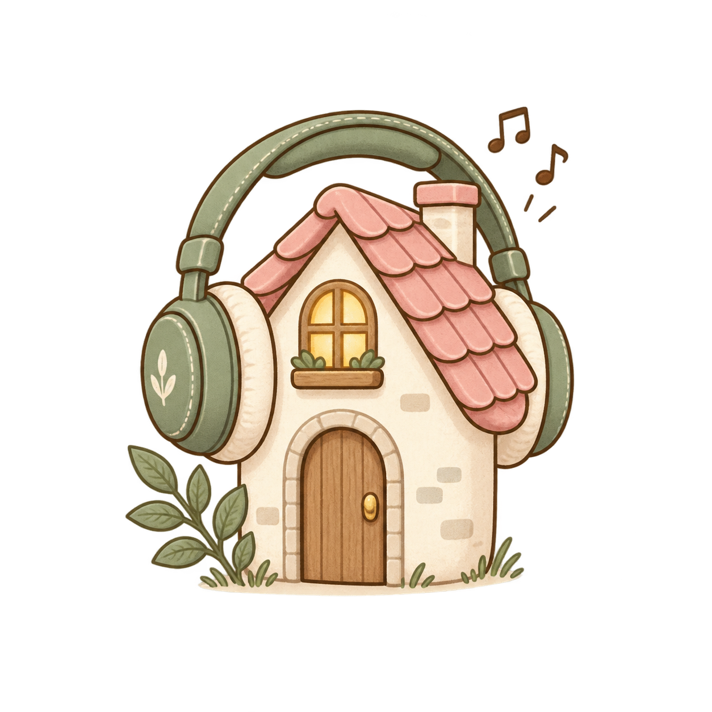

# KotiloPlay 🎧

A cozy music companion with animated scenery, room-based playlists, and planned YouTube integration.

Inspired by the homepage of my home inventory app, [Kotilo](https://kotilo-nu.vercel.app/), this project turns a little house and garden into a relaxing place to enjoy music.

## The idea

Each room will offer a different listening mood:

- Bedroom — sleep and relaxation
- Living room — cozy listening
- Office — focus and studying
- Kitchen — cooking and everyday moments
- Garden — nature sounds and outdoor ambience
- Bathroom
- Hallway

## Current progress

The visual foundation is in place:

- Cozy house layout with interactive room links
- Animated clouds, birds, and chimney smoke
- Woodland scenery, a fence, and garden decorations
- Soft colors and warm window details

The room links are currently UI placeholders. Music playback is not implemented yet.

## Planned features

- Room-based music selections
- YouTube player integration
- SVG artwork stored in separate files
- Refined mobile and tablet layouts
- Installable progressive web app (PWA)
- Deployment on Vercel

## Tech stack

- React
- TypeScript
- Vite
- React Router
- CSS and SVG

## Getting started

### Requirements

- Node.js and npm
- Git

### Run locally

Clone the repository, open the project folder, and install the dependencies:

    npm install

Start the development server:

    npm run dev

Open the local URL shown in your terminal.

### Build for production

    npm run build

Preview the production build locally:

    npm run preview

### Check code quality

    npm run lint

## Learning goals

KotiloPlay is a personal learning project focused on:

- Building reusable React components
- Working with SVG assets and animation
- Creating responsive, accessible interfaces
- Integrating a media player
- Learning PWA setup and deployment

## Project status

Early development. The cozy homepage is ready as a starting point, and music features will be added step by step.